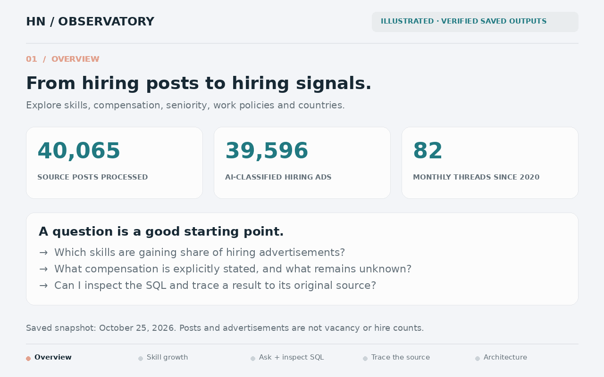
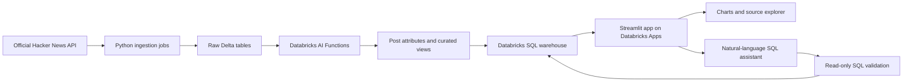

# HN Hiring Observatory

**AI-powered tech hiring analytics, built end to end on Databricks.**

Turn **40,065 Hacker News posts** into an explorable history of skills,
compensation, seniority, work policies and countries. Compare trends, inspect the
original advertisements, or ask questions in plain English and see the SQL behind
the answer.

[25-second walkthrough](docs/assets/walkthrough.gif) ·
[75-second captioned video](docs/assets/walkthrough.mp4) ·
[Live application — workspace access required](https://hn-hiring-observatory-7474647140884875.aws.databricksapps.com)



*Illustrated walkthrough using verified saved outputs; the layouts explain the
workflow. [Static preview](docs/assets/overview.png) · [Media provenance and actual-UI recording guide](docs/demo.md).*

| Historical coverage | Processed source posts | Classified hiring ads | Extraction models compared |
| --- | ---: | ---: | ---: |
| 82 months · Jan 2020–Oct 2026 | 40,065 | 39,596 | 5 |

*Recorded October 25, 2026. October is partial. Counts describe advertisements and
source posts, not individual vacancies or actual hires.*

## The problem

Monthly “Who is hiring?” threads contain useful hiring signals, but their
free-text format makes comparisons difficult. A company might advertise several
roles, describe remote restrictions in prose, omit salary details, or mention a
technology only as a nice-to-have.

This project preserves the original text, extracts structured attributes, and
makes the resulting patterns inspectable. It is intended for people exploring
technology demand and for analysts who want to verify the source behind a chart.

## What you can do

| Workflow | What the application provides |
| --- | --- |
| Follow the market | Monthly hiring activity and filters for date, country, work policy and seniority |
| Compare technologies | Skill prevalence over time and growth in share of hiring advertisements |
| Explore compensation | Explicit numeric ranges, separated by currency, pay period and compensation type |
| Ask the data | Natural-language questions with generated SQL, returned results and downloads |
| Verify an example | Searchable, paginated posts with source text, extraction evidence and original HN links |
| Inspect reliability | Month-by-month ingestion/processing coverage and visible quality-review flags |

**Example finding:** Rails appeared in 24 of 934 hiring ads in Q2 2026 and 32 of
714 in Q3. Its share increased from **2.57% to 4.48% (+1.91 percentage points)**.
The comparison uses shares because the total volume of hiring ads changed.
[Executed SQL](sql/fastest_growing_skills.sql) · [Recorded results](quality/skill-growth-results.json)

## How it works



**Stack:** Python · Databricks AI Functions (`ai_query`) · Delta tables · Unity
Catalog · Databricks SQL · Streamlit · Plotly · SQLGlot · Declarative Automation
Bundles.

The chat assistant uses a Databricks-hosted model to propose SQL. The app checks
for a single read-only query, permitted functions and project tables before
executing it. Answers expose the SQL and results. The production chat path is
implemented directly with AI Functions; the earlier Genie experiment is separate.

## Engineering decisions

- **Resume instead of repeat.** Ingestion and inference checkpoint their progress;
  successful extraction outputs are reused by input hash, model and prompt hash.
- **Compare models on the same task.** Five models received the same frozen
  20-post development cohort, prompt, schema and generation limits. GPT OSS 120B
  led the raw complete-post checks at **19/20**. This is a development comparison,
  not a corpus-wide accuracy estimate.
- **Keep uncertainty visible.** Missing salary facts remain unknown. A bare dollar
  sign is not treated as USD, and an unstated pay period is not assumed annual.
- **Count at a defensible grain.** The default is distinct advertisements. Skill
  growth uses all hiring ads as its denominator, including ads with no named
  technologies. Post attributes can span several roles.
- **Deploy with a managed identity.** The app receives resource IDs through
  configuration and uses its own service identity to read the six required
  tables/views, use the warehouse and query the chat model.

## Evidence and validation

| Check | Recorded result | Evidence |
| --- | --- | --- |
| Historical ingestion | 82 monthly threads; zero missing months, duplicate comment IDs or fetch errors | [Ingestion report](quality/ingestion-results.json) |
| Full extraction | 40,065 distinct successful outputs; zero missing input hashes or incomplete outputs | [Coverage and quality report](quality/full-extraction-results.json) |
| Model selection | Five models compared; GPT OSS 120B selected | [Comparison results](quality/model-comparison-results.json) |
| Application | 10 automated tests; 14 live queries; all six screens exercised with live data through Streamlit AppTest | [Tests](tests/) · [Live query checks](quality/app-live-results.json) · [UI checks](quality/local-ui-results.json) |
| Chat | Skill-growth counts and denominators matched reference SQL; source links and an unsupported question checked | [Reference comparison](quality/app-live-results.json) · [Chat checks](quality/app-chat-results.json) |
| Deployment | Data and chat checks passed inside the deployed service identity; authenticated page and health endpoint returned HTTP 200 | [Deployment verification](quality/deployment-results.json) |

## Run locally

Prerequisites: Python 3.11+, the Databricks CLI, and access to a workspace with the
project's tables, SQL warehouse and chat model. The included deployment settings
describe the existing workspace; select your Databricks profile explicitly.

```sh
git clone https://github.com/Sufi-to/hn-hiring-observatory.git
cd hn-hiring-observatory
python3 -m venv .venv
.venv/bin/pip install -r app/requirements.txt
# Authenticate the chosen profile before starting the app.
.venv/bin/python run_local.py --profile tom
```

Open **http://127.0.0.1:8501**. The UI runs locally; queries and model calls run in
Databricks. See the [operations guide](docs/operations.md) for authentication,
ingestion, extraction, validation and deployment commands.

## Boundaries and next steps

- HN is a self-selected source; this project does not measure the whole tech job
  market. Deleted/dead historical text is unavailable, and partial months are labeled.
- Extracted attributes describe entire posts, which may contain multiple roles.
  A country, skill or work policy does not automatically apply to every opening.
- Mechanical checks do not establish factual accuracy. The saved snapshot has
  153 evidence-quote flags, 30 country-review flags and four invalid salary-bound
  posts. Compensation charts exclude invalid bounds and ambiguous comparison fields.
- Next improvements are broader held-out extraction/chat evaluation, review of
  flagged outputs, and expansion of the normalized skill taxonomy.

The repository is currently private, and the live app requires approved Databricks
access. The included GIF, video and saved reports can be reviewed without a
Databricks account by people who have repository access.

[Operations and deployment](docs/operations.md) ·
[Demo and recording guide](docs/demo.md) ·
[Reusable project skills](skills/) ·
[SQL examples](sql/)
